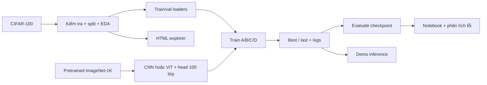

# Design — Thiết kế và kế hoạch triển khai

Cập nhật: 14/11/2026. Đã có model/loader/logger và smoke; tuning/final/evaluate/demo còn là thiết kế.
Giảng viên đã xác nhận ViT classification trên CIFAR-100, không kết hợp Anti Face Deepfake.
Định nghĩa bài toán: [Define](../define/Requirements_Analysis.md). Hiện trạng: [progress](../progress.md).

## 1. System architecture — Kiến trúc hệ thống

Pipeline local theo bước, dùng chung data/model/config, lưu artifact để báo cáo và demo đọc lại.
Không xây backend service hoặc REST API trong phạm vi hiện tại.



## 2. Modules — Trách nhiệm và phụ thuộc

| Module/script | Trách nhiệm | Đọc / ghi |
|---|---|---|
| config.py | Đường dẫn, data, model, run và tham số | Khai báo, không tự train/tải |
| data.py | Dataset, split, preprocessing, DataLoader | data/ và split JSON |
| model.py | Nạp pretrained, thay head, freeze/fine-tune | Weights; trả model và metadata |
| logger.py | Config/máy, log epoch, history và checkpoint | Một thư mục run riêng |
| 1_eda.py | Khảo sát data, RGB gzip và tọa độ 2D | eda/split/projection JSON và data/ |
| 2_train.py | Setup, vòng train/val trực tiếp, resume | Best/last, history, log |
| 3_evaluate.py | Nạp checkpoint, infer, tính metric | Metric và predictions theo split |
| 4_demo.py | Dự đoán một ảnh với checkpoint | Top-5, không tự train/test |

Shared modules không có tác dụng phụ khi import; không import script đánh số.
Train/evaluate có main guard khi dùng worker trên Windows; không giấu loop trong framework.
Notebook mặc định chỉ đọc artifact, không tải weights, train hoặc test khi Run All.

## 3. Model và ma trận thí nghiệm

| Mã | Model | Backbone | Head mới |
|---|---|---|---|
| A | ResNet-50 | Freeze toàn bộ | Linear(2048, 100) |
| B | ResNet-50 | Fine-tune toàn bộ | Linear(2048, 100) |
| C | ViT-B/16 | Freeze toàn bộ | Linear(768, 100) |
| D | ViT-B/16 | Fine-tune toàn bộ | Linear(768, 100) |

Mỗi run bắt đầu từ pretrained tương ứng, seed ban đầu cố định; không tiếp tục từ run khác.
Freeze: head train, backbone eval; fine-tune: model train, chính sách BatchNorm phải ghi rõ.
Validation/test: model.eval(), inference_mode/no_grad; không cập nhật tham số hoặc running statistics.
Chọn rõ IMAGENET1K_V1 cho cả hai; khác recipe/quy mô nên không tuyên bố công bằng tuyệt đối.
Chi tiết: [ResNet-50](ResNet50.md), [ViT-B/16](ViT_B16.md).
Lộ trình smoke → 8 pilot LR ngắn → 4 final → test: [Training_Strategy.md](Training_Strategy.md).

## 4. Folder structure — Cấu trúc

```text
coursework_vit_classification/
├── README.md, requirements.txt
├── Coursework_Report.ipynb
├── docs/
│   ├── progress.md, AI_usage.md, Audit_Log.md, CHANGELOG.md, src.md
│   ├── define/Requirements_Analysis.md
│   └── design/
│       ├── Implementation_Plan.md
│       ├── Data_EDA.md
│       ├── Training_Strategy.md
│       ├── ResNet50.md
│       └── ViT_B16.md
├── src/
│   ├── config.py, data.py, model.py, logger.py
│   └── 1_eda.py, 2_train.py, 3_evaluate.py, 4_demo.py
├── visualization/explorer.html
├── data/                         # Dataset/pixel/cache local, không commit
└── outputs/
    ├── cifar100_split.json, eda.json, projection.json
    └── runs/lan_N/               # Chỉ sinh khi thực sự train
        ├── config.json, train.log, history.json
        ├── best.pt, last.pt
        └── evaluation/           # Metric và predictions theo split
```

## 5. Data flow — Luồng dữ liệu và trạng thái

1. Nạp CIFAR-100 và split hiện có; kiểm tra nhãn/IDs/integrity, chốt chính sách ảnh trùng.
2. Train nhận augmentation; val/test xác định; cùng input 224 và normalization phù hợp weights.
3. Nạp pretrained, thay head rồi đặt requires_grad/mode theo A–D trước khi tạo optimizer.
4. Train tính CrossEntropyLoss trên logits; backward/optimizer chỉ cập nhật tham số được mở.
5. Val cuối epoch chọn best; lưu last với optimizer/RNG và scheduler/scaler nếu có.
6. Resume từ epoch hoàn tất, đối chiếu model/config/split; chưa hỗ trợ resume giữa batch.
7. Sau khóa bốn cấu hình, test checkpoint tốt nhất từng run; không tuning tiếp trên test.
8. Notebook đọc kết quả; demo tái dùng model/preprocessing theo metadata checkpoint.

Epoch log gồm train/val loss, accuracy, LR và thời gian; đầu run ghi cấu hình máy/model/precision.
Đánh giá train/val/test cùng best checkpoint và transform xác định khi phân tích generalization gap.

## 6. Interfaces/APIs — Giao diện nội bộ dự kiến

Không triển khai HTTP API; giao diện chính là cấu hình Python, hàm dùng chung và artifact.
Hàm đã có xem docs/src.md; build_model/loaders/save_checkpoint đã triển khai, write_epoch còn dự kiến.

| Giao diện | Input → output / quy ước |
|---|---|
| load_datasets(download=False) | Dataset gốc train/test; đã có trong data.py |
| load_split(targets) | Train IDs/val IDs đã kiểm tra; đã có |
| build_loaders(batch_size, num_workers, train_images, val_images) | Train/val loaders và classes; không mở test |
| build_model(name, strategy, pretrained) | Model 100 logits; metadata ghi riêng trong config run |
| save_checkpoint(path, model, optimizer, scaler, epoch, generator, settings) | Ghi tạm rồi replace |
| write_epoch(metrics, run_dir) | Một dòng log/epoch và history có epoch rõ ràng |
| model(images) | Tensor B×3×224×224 → logits B×100 |

Config lưu model/weights, A–D, phase/candidate/LR, seed, split, preprocessing, optimizer và budget.
Checkpoint lưu state_dict, tên model/head/classes, epoch, config, trạng thái resume và best score.
Predictions giữ ID/split/true/pred và vector 100 xác suất; metric ghi checkpoint và cách averaging.
TensorBoard chưa là phụ thuộc bắt buộc; chỉ thêm khi cần, không tạo live log từng batch.

## 7. Milestones — Mốc thực hiện và nghiệm thu từng phần

| Mốc / tuần tương đối | Công việc | Điều kiện chuyển bước |
|---|---|---|
| M1 / tuần 1 | Define/design, data/EDA, chính sách duplicate | Có split/protocol được rà soát |
| M2 / tuần 1 | Model + smoke A–D | Audit checklist đạt, có bằng chứng và giới hạn |
| M3 / tuần 2 | 8 pilot LR ngắn, chọn val, train 4 final | Có bảng tuning, best/last và resume kiểm chứng |
| M4 / tuần 3 | Evaluate và phân tích lỗi | Kết quả tái tính được từ predictions |
| M5 / tuần 4 | Report, demo, tái lập và trình bày | Run All an toàn, demo chạy, công bố giới hạn |

Tuần là kế hoạch tương đối, không giả định đã hoàn tất theo ngày lịch; tiến độ thật ghi ở progress.
Vai trò dự kiến: 1 tích hợp/train; 2 data/EDA; 3 test/checkpoint; 4 đánh giá; 5 demo; 6 report/tái lập.
Chưa gán tên; người tích hợp chính rà soát đầu vào/đầu ra giữa các phần.

## 8. Technical risks — Rủi ro và quyết định còn mở

| Rủi ro | Cách kiểm soát / trạng thái |
|---|---|
| ViT fine-tune OOM GPU 4 GB | Smoke batch nhỏ/AMP; đo rồi thống nhất GPU, không tự đổi model |
| 12 nhóm duplicate xuyên split | Chốt giữ protocol và công bố, hoặc lọc train/val và version split trước train |
| ResNet/ViT khác tham số, recipe | Ghi rõ hạn chế; chưa đáp ứng mở rộng cùng số tham số |
| Batch nhỏ ảnh hưởng BatchNorm | Kiểm tra policy BN; accumulation không thay thống kê BN |
| Train lâu hoặc bị ngắt | Đo pilot, lưu last/resume epoch; không hứa thời gian chưa đo |
| Overfit, lệch cơ hội tuning | Cùng split/ngân sách epoch, tuning tương đương, không chọn theo test |
| LR/WD/scheduler/batch/epoch chưa chốt | Đề xuất AdamW; chốt giá trị sau smoke, không tăng hàng loạt run |
| Attention bị diễn giải quá mức | Mở rộng sau; cần cơ chế lấy attention đúng, không coi là giải thích nhân quả |

Inference benchmark cần cùng máy/batch/precision/warm-up; tách forward-only khỏi end-to-end.
Chưa tuning/full train/test; kết quả smoke ở Audit_Log không đại diện chất lượng cuối.
