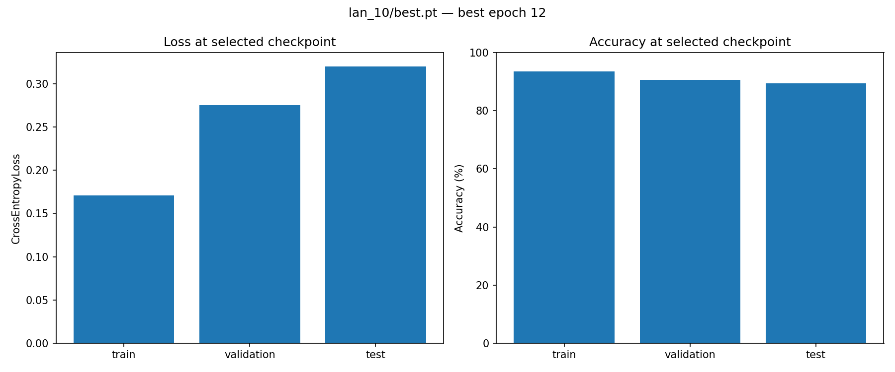
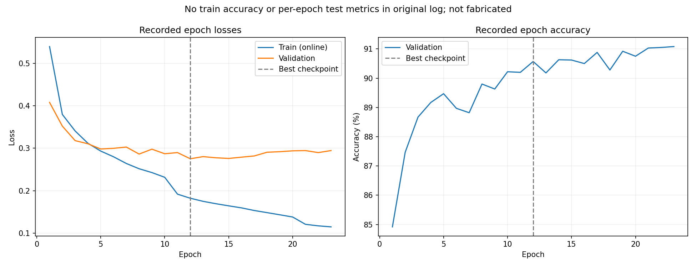
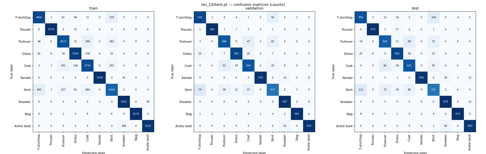
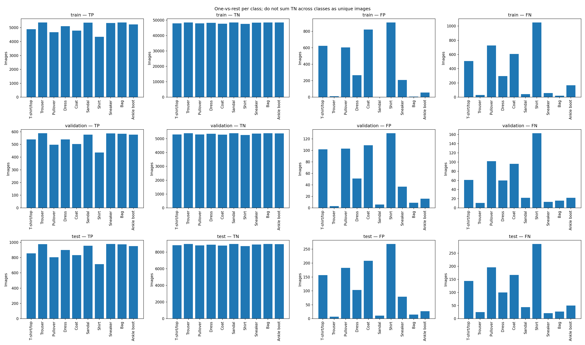

# 04 — Kết quả và mô hình được chọn

## 1. Kết luận

Chốt sử dụng **MLP của `lan_10`, checkpoint `best.pt` tại epoch 12** cho bài 1.
Checkpoint được chọn theo **validation loss thấp nhất trong lần train 10**,
không chọn theo test accuracy. Kết quả validation đạt **90,57%**, test đạt **89,41%**.
Đây là mô hình được chọn để bàn giao bài thực hành, chưa chứng minh là cấu hình tối ưu toàn cục.

Trọng số: [lan_10/best.pt](../outputs/runs/lan_10/best.pt).
Bằng chứng: [train.log](../outputs/runs/lan_10/train.log) và
[model_report.json](../outputs/runs/lan_10/model_report.json).

## 2. Dữ liệu và cách chuẩn bị

- FashionMNIST gồm 70.000 ảnh grayscale 28 × 28, thuộc 10 nhãn quần áo/phụ kiện.
- Tách 60.000 ảnh train gốc thành 54.000 train và 6.000 validation bằng stratified split, seed 42.
- Mỗi nhãn có 5.400 ảnh train, 600 validation và 1.000 test; test giữ nguyên 10.000 ảnh gốc.
- `ToTensor()` chuyển ảnh thành float32 trong [0,1], kích thước [1,28,28].
- Batch size 64; train được shuffle, validation/test không shuffle.
- Không augmentation, không dùng K-fold trong thí nghiệm này.

Nguồn: [data_source.md](data_source.md). Quy trình: [02_data_preparation.md](02_data_preparation.md).

## 3. Cấu hình được chọn

| Thành phần | Cấu hình thực tế của lan_10 |
|---|---|
| Kiến trúc | Flatten → Linear(784,256) → ReLU → Linear(256,128) → ReLU → Linear(128,10) |
| Số tham số | 235.146 |
| Đầu ra | 10 logits; nhãn dự đoán lấy bằng argmax |
| Loss | CrossEntropyLoss, reduction=mean, label_smoothing=0 |
| Optimizer | Adam, lr=0,001, betas=(0,9; 0,999), eps=1e-8, weight_decay=0 |
| LR decay | StepLR, step_size=10, gamma=0,3 |
| Seed | 42 |
| Epoch dự kiến / ghi nhận | 30 / 23 |
| Tiêu chí lưu best.pt | Validation loss thấp nhất sau mỗi epoch |
| Checkpoint được chọn | Epoch 12, validation loss 0,275095 |
| Thiết bị train | NVIDIA GeForce RTX 3050 Laptop GPU, CUDA |

Log ghi nhận đến epoch 23/30; không báo cáo rằng lần train đã hoàn thành 30 epoch.
Epoch 12 sử dụng lr=0,0003 sau lần giảm learning rate đầu tiên.

## 4. Đánh giá cùng checkpoint trên ba tập

Các kết quả dưới đây được tính lại từ cùng `best.pt`, với `model.eval()` và không tính gradient.
Loss là CrossEntropyLoss trung bình theo số ảnh.

| Tập | Số ảnh | Loss | Accuracy | Đúng | Sai |
|---|---:|---:|---:|---:|---:|
| Train | 54.000 | 0,170986 | 93,50% | 50.491 | 3.509 |
| Validation | 6.000 | 0,275095 | 90,57% | 5.434 | 566 |
| Test | 10.000 | 0,320097 | 89,41% | 8.941 | 1.059 |

Test thấp hơn validation **1,16 điểm phần trăm**, và thấp hơn train **4,09 điểm phần trăm**.
Mô hình tổng quát hóa khá tốt cho bài thực hành nhưng vẫn có khoảng cách giữa train và dữ liệu ngoài train.

## 5. Diễn biến huấn luyện và lựa chọn checkpoint

Train loss giảm từ 0,5392 ở epoch 1 xuống 0,1148 ở epoch 23.
Validation loss thấp nhất tại epoch 12, sau đó dao động và lên 0,294396 ở epoch 23.
Diễn biến này cho thấy tiếp tục giảm train loss không đảm bảo cải thiện validation loss;
có dấu hiệu overfitting sau giai đoạn tốt nhất theo tiêu chí loss.

Validation accuracy tại epoch 23 đạt 91,08%, cao hơn epoch 12 (90,57%),
nhưng validation loss lớn hơn. Vì tiêu chí đã dùng là **minimum validation loss**,
checkpoint chốt vẫn là epoch 12; không gọi đây là checkpoint có accuracy cao nhất.

Train loss theo epoch được đo trong lúc trọng số liên tục cập nhật.
Train loss 0,170986 trong bảng kết quả được đo lại với checkpoint cố định;
hai phép đo này có ý nghĩa khác nhau.

Log không ghi train accuracy hoặc test loss/accuracy từng epoch, nên không có đường lịch sử cho các chỉ số đó.
Test chỉ được thể hiện bằng kết quả đánh giá checkpoint, không được bổ sung số liệu giả vào biểu đồ epoch.

## 6. Confusion matrix và lỗi phân loại

Confusion matrix dùng hàng là nhãn thật, cột là nhãn dự đoán; đường chéo là dự đoán đúng.

Các cặp nhầm nổi bật trên test:

| Nhãn thật → nhãn dự đoán | Số ảnh |
|---|---:|
| Shirt → T-shirt/top | 112 |
| T-shirt/top → Shirt | 109 |
| Pullover → Coat | 98 |
| Coat → Pullover | 84 |
| Pullover → Shirt | 72 |
| Shirt → Pullover | 72 |

Shirt có recall thấp nhất: **71,50%**; Pullover **80,40%**, Coat **83,30%**.
Sneaker đạt **97,90%**, Trouser **97,50%**, Bag **97,30%** recall trên test.
Lỗi tập trung ở các loại áo có hình dáng gần nhau; MLP sau Flatten không khai thác cấu trúc không gian như CNN.
Đây là giải thích phù hợp với dạng lỗi quan sát được, chưa phải kết luận nhân quả đã kiểm chứng.

TP/TN/FP/FN được tính riêng cho từng nhãn theo cách **nhãn đó so với tất cả nhãn còn lại**.
TN lớn trong bài 10 lớp không đủ để kết luận một nhãn được phân loại tốt; cần xem thêm precision và recall.

Mở [explorer.html](../visualization/explorer.html) bằng Live Server, vào phần đánh giá model
để xem thông số, chọn train/validation/test, lọc ô confusion matrix và xem ảnh sai kèm nhãn thật/dự đoán.

## 7. Giới hạn và trạng thái bàn giao

- Chốt `lan_10/best.pt` cho báo cáo này, giữ nguyên các log và checkpoint cũ.
- Chưa kiểm tra độ ổn định qua nhiều seed; không khẳng định các chênh lệch nhỏ giữa run là có ý nghĩa thống kê.
- Test đã được xem ở nhiều lần thử trước đó, nên kết quả 89,41% cần được hiểu trong bối cảnh này;
  không coi đây là đánh giá cuối hoàn toàn độc lập với quá trình thử nghiệm.
- Không huấn luyện thêm hoặc thay đổi tham số trong bước viết báo cáo.
- Bài đã có script chuẩn bị dữ liệu, train, evaluate/test, checkpoint và trực quan hóa kết quả.

Hướng dẫn chạy và các script: [README](../README.md).
