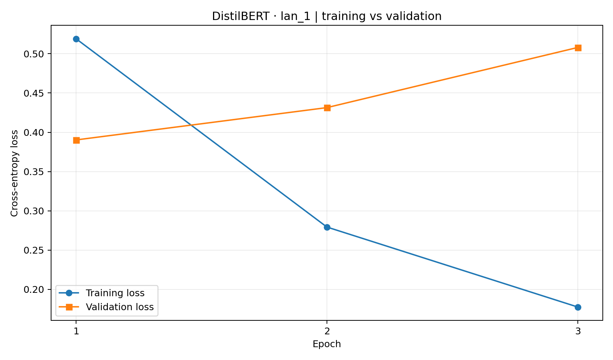
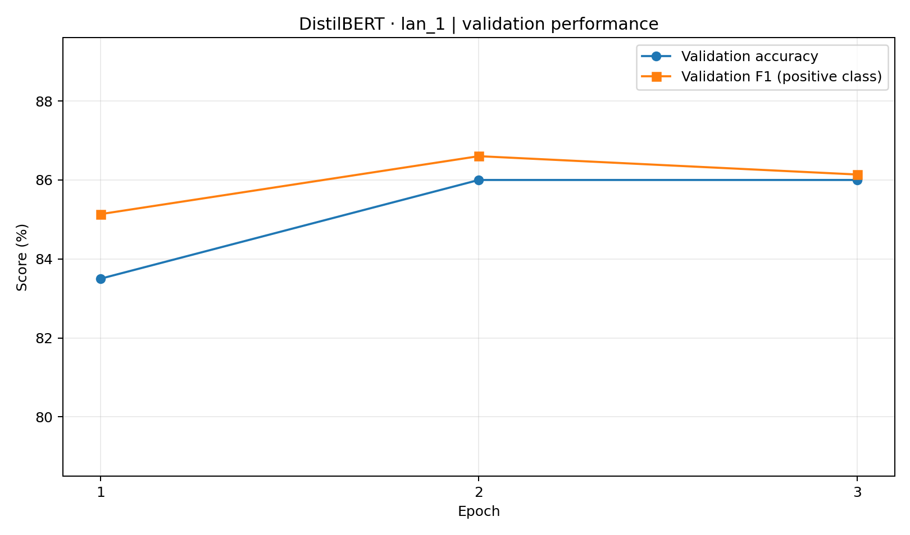
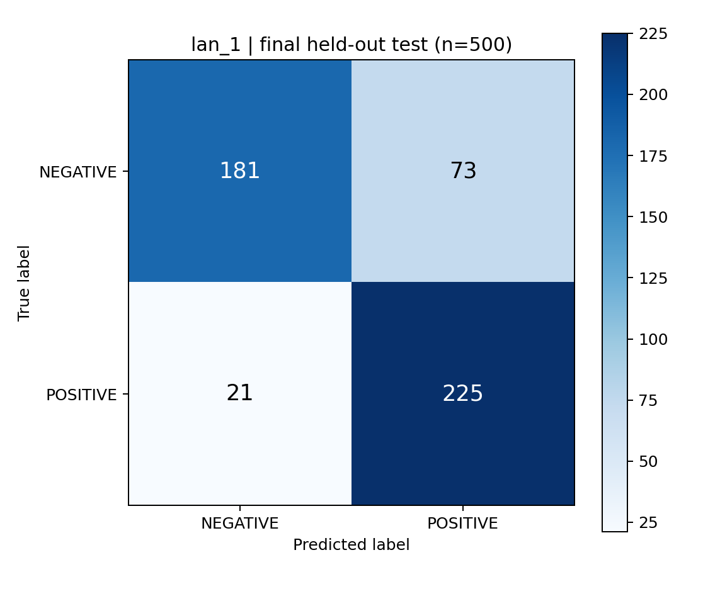

# Practice 3 — Experiment report: `lan_1`

> Evidence-based report generated from saved training and evaluation artifacts. Training metrics, validation metrics and final test metrics are explicitly separated.

## 1. Objective and method

Fine-tune pretrained DistilBERT on labeled IMDb reviews for binary sentiment classification (NEGATIVE = 0, POSITIVE = 1). The validation set selects the checkpoint; the held-out test set is used for one final evaluation. Reference baselines (majority class and a zero-shot pretrained SST-2 classifier) are stored separately in `outputs/baseline/`.

## 2. Experiment configuration

- Pretrained backbone: `distilbert/distilbert-base-uncased`
- Dataset: `stanfordnlp/imdb`
- Samples: train **2000**; validation **400**; test **500**
- Epochs: **3**; batch size: **8**; learning rate: **2e-05**; weight decay: **0.01**
- Max tokens per review: **128**; random seed: **42**
- Checkpoint selection: **highest validation F1 for positive class**, per run configuration.

## 3. Training and validation results

| Epoch | Training loss* | Validation loss | Validation accuracy | Validation F1 (positive) |
|---:|---:|---:|---:|---:|
| 1 | 0.5190 | 0.3903 | 83.50% | 85.14% |
| 2 | 0.2794 | 0.4314 | 86.00% | 86.60% |
| 3 | 0.1776 | 0.5080 | 86.00% | 86.14% |

*Training losses above are epoch-level values logged by Hugging Face Trainer; they are not validation measurements.*

The highest validation F1 occurred at **epoch 2** (F1 **86.60%**, accuracy **86.00%**). The lowest validation loss occurred at **epoch 1** (0.3903); selecting by F1 is different from selecting by loss.

The post-training validation recheck of the selected model recorded accuracy **86.00%**, F1 **86.60%**, and loss **0.4314**. This is still **validation**, not test performance.

## 4. Final test results (held-out)

The frozen model was evaluated on **500** held-out IMDb reviews.

| Metric | Final test |
|---|---:|
| Accuracy | **81.20%** |
| Cross-entropy loss | 0.5371 |
| Precision (positive) | 75.50% |
| Recall (positive) | 91.46% |
| F1 (positive) | 82.72% |
| Macro F1 | 81.05% |
| ROC-AUC | 0.9165 |

### Per-class scores

| Class | Precision | Recall | F1 | Support |
|---|---:|---:|---:|---:|
| NEGATIVE | 89.60% | 71.26% | 79.39% | 254 |
| POSITIVE | 75.50% | 91.46% | 82.72% | 246 |

### Confusion matrix (rows = true labels; columns = predictions)

| True \ Predicted | NEGATIVE | POSITIVE |
|---|---:|---:|
| NEGATIVE | 181 | 73 |
| POSITIVE | 21 | 225 |

Correct: **406/500**; false positives: **73**; false negatives: **21**.

## 5. Discussion

**Generalization gap:** epoch-level training loss fell from 0.5190 to 0.1776, while validation loss rose from 0.3903 to 0.5080. This is evidence consistent with overfitting; it does not establish the cause by itself.

**Generalization to test data:** final test accuracy (81.20%) was **4.80 percentage points** below selected-checkpoint validation accuracy (86.00%). Sampling variability and differences between subsets may contribute; no causal explanation is proven.

**Asymmetric errors:** 73 NEGATIVE reviews were incorrectly labeled POSITIVE, versus 21 POSITIVE reviews incorrectly labeled NEGATIVE. By recall, POSITIVE reviews (91.5%) are detected more reliably than NEGATIVE reviews (71.3%).

## 6. Limitations and validity

- **Limited data:** the run used only a small subset of IMDb; the test set contains 500 samples, so estimated performance is subject to sampling variation.
- **Single seed:** only this run is analyzed; replicate seeds would help quantify stability.
- **Truncation:** input is limited to the configured number of tokens; longer reviews may lose sentiment cues.
- **Dataset specificity:** IMDb reviews do not establish transfer to social media, other languages, or other domains.
- **Model selection:** best checkpoint was selected on validation F1, not validation loss; do not tune hyperparameters based on this final test set.
- **Calibration:** high classification confidence is not proof of well-calibrated probabilities.

## 7. Conclusion

This run demonstrates supervised fine-tuning of a pretrained model plus held-out evaluation. The reported figures are observational results for this run, not guarantees of general performance.

## 8. Traceable artifacts

- `outputs/runs/<run>/config.json` — saved hyperparameters and selection rule.
- `outputs/runs/<run>/history.json` and `train.log` — recorded Trainer history.
- `outputs/runs/<run>/validation_metrics.json` — selected-checkpoint validation recheck.
- `outputs/runs/<run>/test_metrics.json` — final test metrics and per-example predictions.
- `outputs/runs/<run>/model/` — selected fine-tuned model and tokenizer.
- `visualization/<run>/` — this report and generated figures.
